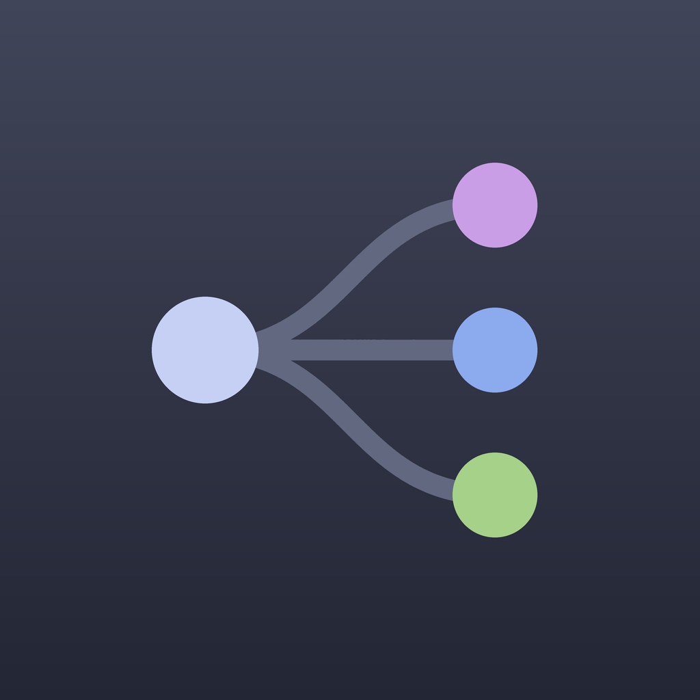
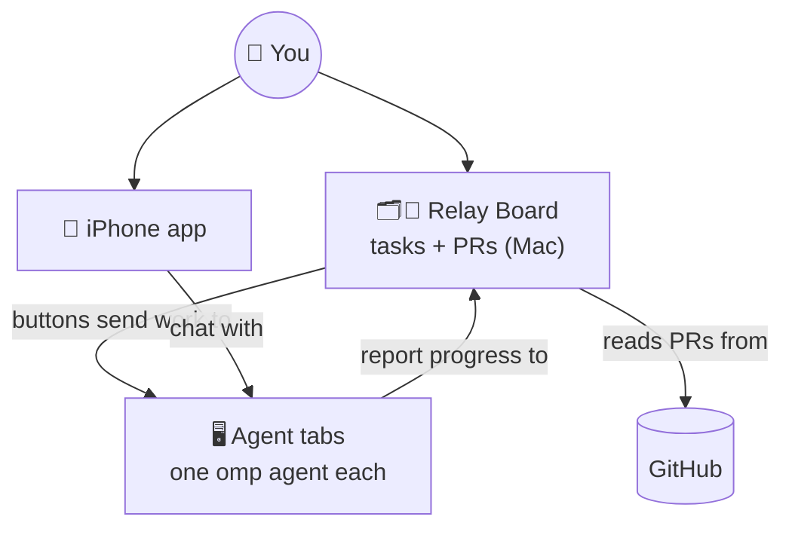
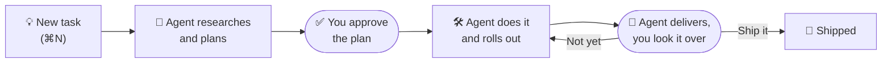

<p align="center">
  
</p>

<h1 align="center">relay</h1>

<p align="center">
  <b>Run a whole crew of coding agents without losing track of any of them.</b>
</p>

<p align="center">
  Terminal tabs for your <a href="https://github.com/can1357/oh-my-pi">omp</a> agents · a Mac board for your tasks and PRs · an iPhone app to check in from anywhere
</p>

---

Five agents going at once is easy. Remembering which one is waiting on you is not. relay keeps all of them in one place and tells you, at a glance, **what's moving, what's stuck, and what needs you**.

| | |
|---|---|
| 💬 **[Chats](#-chats)** | Every agent session as a conversation on your Mac: read it live, type to it, or start a new one. |
| 🗂️ **[Tasks](#️-tasks)** | Everything you're getting done, sorted by what it needs from you. Your agents keep it up to date. |
| 🔀 **[Pull requests](#-pull-requests)** | Every open PR on its way from draft to merged, with one button for its next step. |
| 🖥️ **[Terminal](#️-terminal)** | One agent per tab. A spinner while it works, a green dot when it finished while you were away. |
| 📱 **[iPhone](#-iphone)** | Read, reply, dictate, and start agents from your phone, even away from home. |



## 🚀 Quick start

```sh
curl -fsSL https://raw.githubusercontent.com/pgeske/relay/main/install.sh | sh
relay                   # open your agents (the first run starts one here)
relay server install    # start the background server the board and phone talk to
relay board             # open Relay Board (or prefix B inside relay)
```

You need [tmux](https://github.com/tmux/tmux) and omp on your `PATH`. relay runs on macOS and Linux; Relay Board needs macOS 26 or newer. The installer puts `relay` in `~/.local/bin` (`RELAY_INSTALL_DIR` changes that) and Relay Board in `~/Applications`.

## 💬 Chats

Relay Board's **Chats** view lists your sessions like a chat app: open ones first (a spinner while they work), then the rest by day. Pick one to read it live, type to it (↩ sends, screenshots paste right in), stop it, answer its questions with a click, or switch its model. Typing into a closed chat reopens it.

**New Chat** (⇧⌘N) starts a fresh omp session from your first message. Its **…** menu adds it to a task anytime, and clicking a task's session opens it here.

## 🗂️ Tasks

A **task** is one thing you want done: a fix, a rollout, an investigation, or getting another team to do something. It can take a few sessions and PRs, or none at all.

Relay Board opens on your tasks as a Kanban board turned on its side: a section per stage, top to bottom, from **Ideas** through **Research**, **Plan**, **Doing**, and **Rollout** to **Ready to ship** and **Shipped**, so the closer a task is to done, the further down it sits. Tasks you've set aside wait in **Blocked**, just above Shipped. Every card has the same shape: a colored pill for whose move it is (**Needs you**, **Agent working**, **Waiting on others**, **Blocked**), then labeled rows for the agent's latest update, its plan, and its PRs. Open sessions that no task knows about show up in a line above the board, so nothing slips through.

Here's the loop:



- **You never chase an agent.** Relay keeps each card's stage and status current by reading the end of the agent's session with a small, fast model, marked **auto**. The agent itself only speaks up at the moments that matter: when it starts, when it has a plan, when it stops waiting on you or others, and when it's done.
- **Just say what you want.** A new task is what you write, nothing more: relay titles the card for you.
- **Nothing ships without you.** A finished task lands in **Ready to ship** with a note on what the agent did and how it checked. One click on **Ship It** and it's shipped.
- **Plans wait for you,** unless you say the task can skip that step.
- **Park what can wait.** **Mark Blocked** from a task's menu and it moves to **Blocked**, saying which stage it was in, until you press **Resume** or **Unblock**.
- **PRs come along.** PRs a task's session opens join the task and wear its color on the PR board.

## 🔀 Pull requests

The board's second view lines up your open PRs by how close they are to shipping:

| Lane | What it means | Next step |
|---|---|---|
| **Draft** | Still being shaped | — |
| **Agent review** | Ready, but no reviewer agent has passed it yet | **Review** |
| **Human review** | Waiting on people's approvals | **Ask for Approval**, then **Bump** |
| **Approved · blocked** | Approved, but CI or GitHub isn't happy yet | Fix what's blocking it |
| **Ready to merge** | Good to go | **Merge** |

Every button hands the work to the agent session that opened the PR, so its whole history stays in one place. Red CI gets a **Fix CI** button in any lane. Approval asks and bumps are always **Slack drafts**: you read them and hit send yourself.

## 🖥️ Terminal

```sh
relay
```

Every tab runs an omp agent, and the tab bar shows each one's state. The first run starts one agent in the current folder; later runs pick up where you left off.

| Keys | Action |
|---|---|
| Ctrl+N | New agent tab in the current folder |
| Ctrl+K | Pick a tab from a list, with each agent's status |
| Alt+Shift+[ / ] | Previous / next tab |
| Ctrl+] | Zoom the current pane |
| Ctrl+B or Ctrl+A | tmux prefix (prefix `d` detaches, prefix `&` closes a tab, prefix `B` opens the board) |

relay brings its own tmux server and config, so your `~/.tmux.conf` and existing tmux sessions are never touched, and every machine looks the same.

## 📱 iPhone

The Relay app shows the same conversations live. Read, reply, answer an agent's questions with a tap, dictate, or start a new agent, from anywhere on your Tailscale network. Pair as many computers as you like:

```sh
relay server install    # once per computer, if you haven't already
relay pair              # scan the QR code with the iPhone Camera app
```

There's also an early, Mac-only **live voice** mode to talk to an agent out loud (`relay voice on`). Build the app from [`ios/`](ios/README.md).

## 🤖 For agents

relay installs an omp skill (`~/.omp/agent/skills/relay`) that teaches agents to keep their task current and record their PR work, so you rarely run these by hand:

```sh
relay task new "Roll out the cache"     # register a task; this session is on it
relay task plan --summary - < plan.md   # waits for approval on the board
relay task update --blocked-on me --reason "Which region goes first?"
relay task done --summary - < done.md   # waits in Ready to ship for you
relay task --json                       # every task, by column
relay board --json                      # every PR, by lane
```

The full details live in two reference docs:

- 📘 [**Relay Board**](docs/board.md): every task section and PR lane, each button, what gets recorded, settings (`~/.config/relay/board.json`), and how the board's endpoints stay local.
- 📗 [**iPhone app**](docs/iphone.md): the phone server, pairing, and live voice setup.

## 🔄 Updates

relay checks for new releases in the background and shows `relay x.y.z available` in the tab bar. Then run `relay update`. It swaps in the new binary (and Relay Board on a Mac), checks its SHA-256, reloads the tmux config, and restarts the phone server. Running agents keep running.

## 📋 Commands

```
relay                    Open relay (creates the session on first run)
relay board              Open the board app: your tasks and PRs (relay board --help)
relay task               Your tasks, which agents keep current (relay task --help)
relay pair [address]     Show a QR code that adds this computer to the Relay iPhone app
relay server             Run the phone server in the foreground
relay server install     Run the phone server in the background, starting at login
relay server uninstall   Stop and remove the background phone server
relay server status      Show whether the background phone server is running
relay voice [on|off]     Turn phone voice calls on or off (off by default; Mac only)
relay update             Install the latest release
relay reload             Re-apply relay's tmux config to the running session
relay version            Print the version
```

## 🧑‍💻 Development

relay is TypeScript compiled into a standalone binary with [Bun](https://bun.sh).

```sh
bun install
bun run dev          # run from source
bun run typecheck
bun test
bun run build        # dist/relay
macos/scripts/build.sh   # build the Relay Board app and install it to ~/Applications
```

`RELAY_TMUX_SOCKET` and `RELAY_PORT` let a development copy run beside your real relay without touching it; `relay board` passes `RELAY_PORT` on to the app.

The Relay Board app in [`macos/`](macos/) is a SwiftUI app built with Swift Package Manager, so it needs only the Command Line Tools with the macOS 26 SDK (Swift 6.2 or newer), not Xcode. `macos/scripts/build.sh` builds it for this Mac, turns the iPhone app's icon into a macOS one, ad-hoc signs the bundle, and installs it as `~/Applications/Relay Board.app`, reopening it if it was open.

To release, bump `version` in `package.json`, commit, and push a matching `vX.Y.Z` tag. The release workflow builds binaries for every platform and the Relay Board app (a universal `relay-board-macos.zip`), publishes them with a `checksums.txt`, and every machine then sees the update.

## License

MIT
